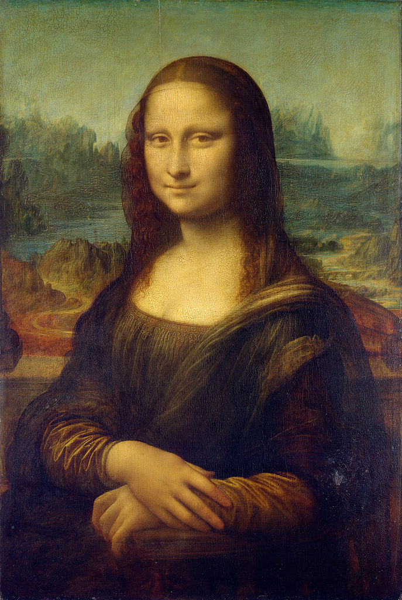

# dct-thumbnail

Thumbnails of images that fit in a few dozen bytes, to show in their place while the image loads.

A thumbnail keeps the lowest frequencies of the image, the ones that say what it looks like from far away. It's small enough to go in the HTML next to the image, so there's something to show before anything is downloaded.

[](https://www.npmjs.com/package/dct-thumbnail)

#### Demo ####
- **[Make a thumbnail, and see it in a page](https://spite.github.io/dct-thumbnail/demo/)**: choose an image to get its thumbnail and the HTML to use it, see an image that shows its thumbnail while it loads, and how to use it step by step

#### 2026 update ####
**Disclaimer:** this library is from 2017. The same idea has become two formats that are widely used and have encoders and decoders for many languages: [BlurHash](https://blurha.sh/) (2018) and [ThumbHash](https://evanw.github.io/thumbhash/) (2023). Use one of those for anything new

Browsers also load images lazily by themselves since 2019, with `loading="lazy"`, which is what this library used to do with its own code.

The library has been rewritten, and what version 1 made can't be read by this one. What changed:

- it's two ES modules with no dependencies. Version 1 needed an old version of the `canvas` package for Node, and its encoder didn't work in a browser
- a thumbnail is 49 bytes, a string of 68 characters that goes in an attribute of the image. It was a PNG file to download, of 16 x 4 pixels, of which only a quarter was used
- the encoder works in the browser, from an image, a canvas or a video, and anywhere else from the pixels
- a thumbnail can be decoded at any size, and it says how many frequencies it has, from 1 to 16 along each side
- the image is a plain ``, that works without scripts and loads lazily with `loading="lazy"`. It was a `<div>` with another inside, a `<noscript>` and the loading done on scroll
- the command line tool is gone. The demo makes the thumbnails, and it takes a few lines to make them in Node

#### How to use ####
Use npm to install it
```
npm i dct-thumbnail
```
It's two plain ES modules, so they also work without a bundler (see [demo/index.html](demo/index.html)).

Make the thumbnail of an image. This is done once, when the image is added to the site, with the [demo](https://spite.github.io/dct-thumbnail/demo/) or with your own code:
```js
import { encode, toBase64 } from 'dct-thumbnail';

const thumb = toBase64( encode( image ) );
// 'BFRGM4qFgXeAh3BzeqizlXd5fYiOh4KAf3qDhH+AgoSGg3x/gYOGhYaGgYqAf4WDgQ=='
```
Put it in the image, as `data-thumb`. Give the image its size, so the page has its place before it loads:
```html

```
And in the page, call `applyThumbnails()` once the images are there:
```js
import { applyThumbnails } from 'dct-thumbnail/loader';

applyThumbnails();
```
Every image with a `data-thumb` that hasn't loaded yet shows its thumbnail as its background, which goes away when the image loads. It returns the images it did it to. Pass an element to look only inside of it, and call it again when images are added to the page: the ones that were done are skipped.

By default the image replaces its thumbnail as soon as it has loaded. To have it fade in, pass how long it takes, in milliseconds:
```js
applyThumbnails( document, { fade: 500 } );
```

#### Encoding ####
`encode( source, coefficients )` returns the thumbnail as a `Uint8Array`.

`source` is an image, a canvas, a video or an `ImageData`. It can also be `{ data, width, height }` with the RGBA pixels of the image, which is how to use it where there's no page, like Node or a worker. With [sharp](https://sharp.pixelplumbing.com/), for instance:
```js
import sharp from 'sharp';
import { encode, toBase64 } from 'dct-thumbnail';

const { data, info } = await sharp( 'mona-lisa.jpg' ).ensureAlpha().raw().toBuffer( { resolveWithObject: true } );
const thumb = toBase64( encode( { data, width: info.width, height: info.height } ) );
```
`coefficients` is how many frequencies are kept along each side, from 1 to 16, and 4 by default. A thumbnail has `1 + 3 * coefficients * coefficients` bytes: 49 with 4, 193 with 8. With 1 it's just the average color.

`toBase64( thumb )` and `fromBase64( string )` turn the bytes into a string and back.

#### Decoding ####
Everything that takes a thumbnail takes the bytes or the string.

- `decode( thumb, width, height )` returns its picture as `{ data, width, height }`, with RGBA pixels. It's 32 x 32 by default, and it can be any size: the picture is smooth at all of them, so a small one stretched by the page looks the same.
- `toCanvas( thumb, width, height )` returns it in a canvas, and `toDataURL( thumb, width, height )` as the URL of a PNG.
- `averageColor( thumb )` returns the average color of the image, like `#544633`.

#### The format ####
The image is reduced to 16 x 16 pixels, and transformed with a [discrete cosine transform](https://en.wikipedia.org/wiki/Discrete_cosine_transform), the one that JPEG uses. The first byte of a thumbnail is the number of frequencies along each side. Then, by rows, come three bytes for each frequency, with its amount of red, green and blue plus 128. The first one is the average color of the image.

The transparency of the image is not kept, and neither is its shape: a thumbnail is stretched to the size it's shown at.

#### License ####

MIT licensed

Copyright (C) 2017 Jaume Sanchez Elias, https://www.clicktorelease.com
